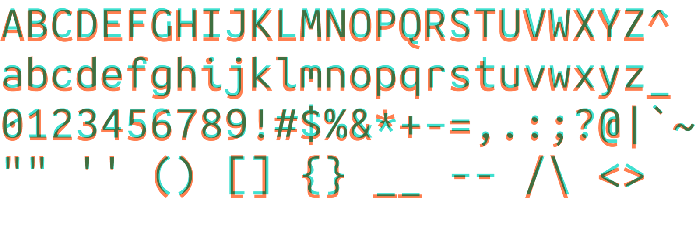
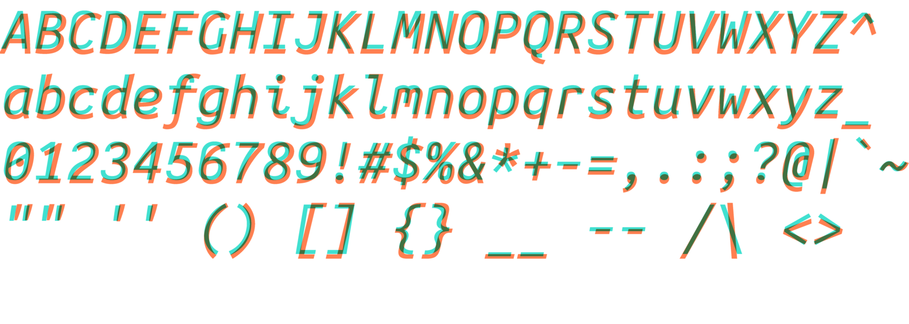
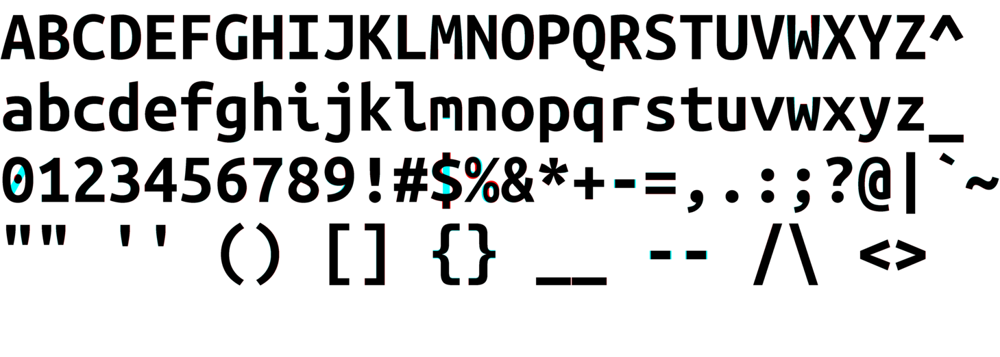
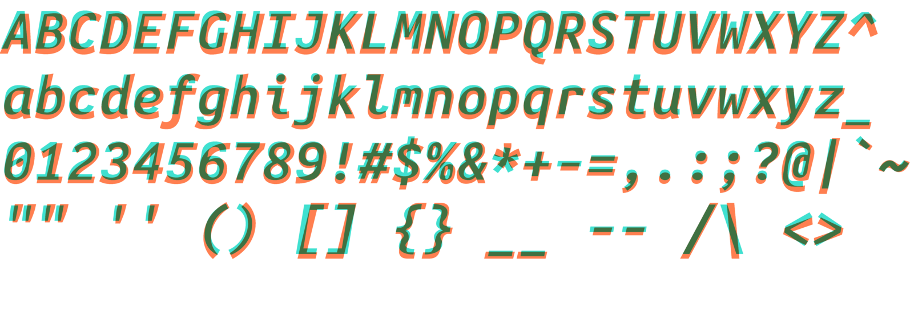

# Jambo Mono Fonts

[Iosevka](https://github.com/be5invis/Iosevka)-derived fonts intended to closely
match the Ubuntu Mono fonts, including
[Nerd fonts](https://github.com/ryanoasis/nerd-fonts) patched variants.

Built with Iosevka 34.9.0 and Nerd Fonts 3.5.1.

[](https://github.com/sudorook/fonts-jambo/actions/workflows/ci.yml)

Fonts are built automatically by
[GitHub Actions](https://github.com/sudorook/fonts-jambo/actions) and published
as [GitHub Releases](https://github.com/sudorook/fonts-jambo/releases). Compiled
font files are no longer committed to this repository.

## Alterations

1. `$` - vertical line through the center.
2. `¢` - vertical line through the center.
3. `0` - diagonal line across the middle instead of a dot.
4. `9` and `6` - curl the bottom/top (helps with hinting at lower sizes).
5. `{` and `}` - make curlier.
6. `8` - make crossing point in middle narrower to better distinguish the glyph
   from `0`.

See below for a comparison between Jambo ('turquoise') and the original Ubuntu
('coral'):









## Installation

### From GitHub Releases (recommended)

The `install` script can download and install fonts directly from the latest
GitHub Release:

```bash
./install --download          # hinted TTF
./install --download -n       # hinted TTF, Nerd-patched
./install --download -u       # unhinted TTF
./install --download -u -n    # unhinted TTF, Nerd-patched
```

Use `--tag <version>` to install a specific release.

### From local build

If you have built the fonts locally (see [Building](#building)), run:

```bash
./install                     # hinted TTF
./install -n                  # hinted TTF, Nerd-patched
```

The script installs to `${HOME}/.local/share/fonts/jambo` (or
`/usr/local/share/fonts/jambo` if run as root).

## Usage

The fonts use the family name `Jambo Mono`, with each file corresponding to
`Regular`, `Bold`, `Italic`, and `Bold Italic` styles. Should these fonts be too
thin, use `Medium` instead of regular and `Heavy` instead of `Bold`.

For the Nerd-patched fonts, the family name is instead `JamboMono Nerd Font`.

## Building

### CI (automatic)

Fonts are built by [GitHub Actions](.github/workflows/ci.yml). The workflow:

1. Clones Iosevka and builds TTF + WOFF2 variants
2. Patches hinted and unhinted TTFs with Nerd Fonts
3. Packages the fonts into three zip archives (`jambo-mono-ttf-<tag>.zip`,
   `jambo-mono-ttf-nerd-<tag>.zip`, `jambo-mono-woff2-<tag>.zip`)
4. Publishes everything to
   [GitHub Releases](https://github.com/sudorook/fonts-jambo/releases)

A build runs when a version tag is pushed (e.g., `v2.3.106`) or when the
workflow is dispatched manually from the
[Actions tab](https://github.com/sudorook/fonts-jambo/actions/workflows/ci.yml).
A weekly scheduled check compares the pinned Iosevka/Nerd Fonts versions against
upstream; when either has a new release it bumps the version, tags the next
patch release, and builds it automatically.

When dispatching manually, the "Use workflow from" selection matters:

- **master**: checks for upstream updates (tagging and building a new release if
  found), otherwise rebuilds the latest tag from the current `master`.
- **a tag**: skips the update check and rebuilds that tag, using the workflow
  file as it exists in that tag.

If a scheduled build fails (for example, because an upstream Iosevka change
breaks `src/4-yBar_tweak.patch`), GitHub emails the workflow owner. Fix the
patch locally, push, and re-run the workflow from `master` in the Actions tab to
rebuild the current tag.

**Note:** GitHub disables scheduled workflows after 60 days without repository
activity. Dispatch the workflow manually to re-enable it.

### Manual

To build locally, install dependencies (`git`, `npm`, `fontforge`,
`python3-fontforge`, `ttfautohint`, `wget`, `unzip`) and run:

```sh
./build
```

Compiled fonts will be placed in `dest/jambo-mono/`.

### Container

```sh
podman build -t jambo-build .
mkdir -p dest
podman run --rm --network host -v "$(pwd)/dest:/home/dest:Z" localhost/jambo-build:latest
```
